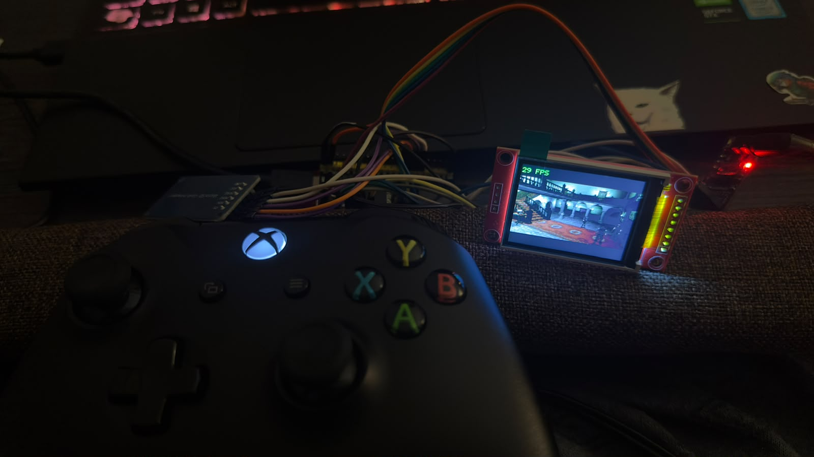
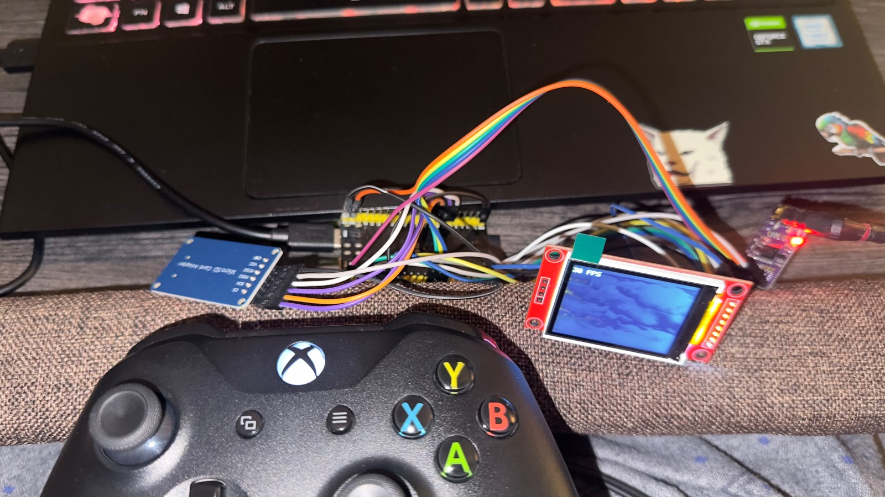
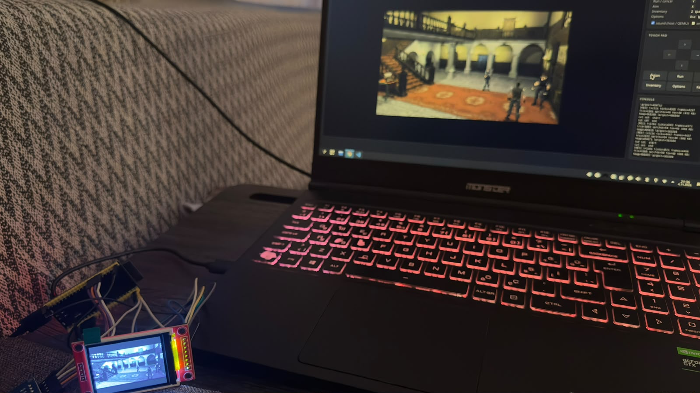
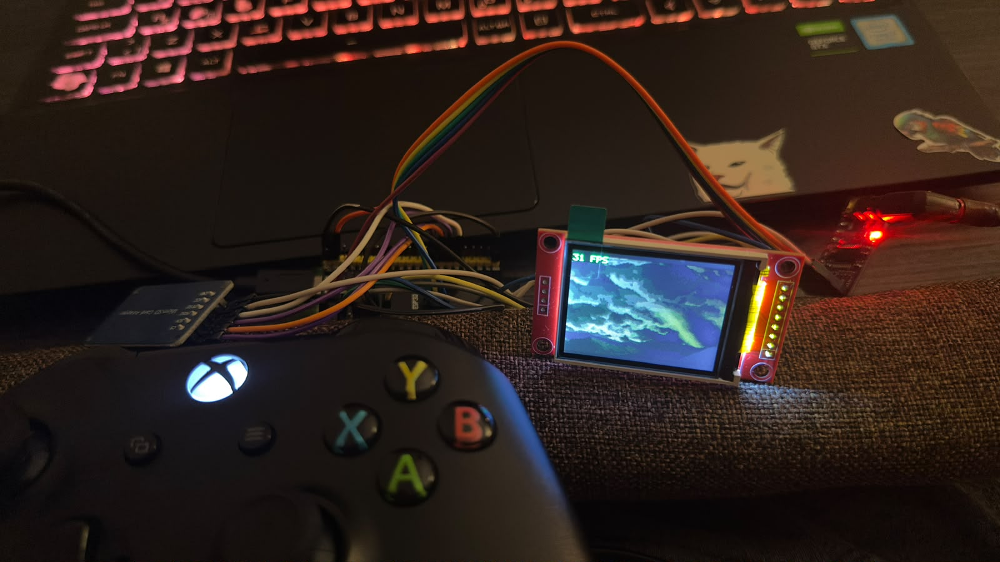
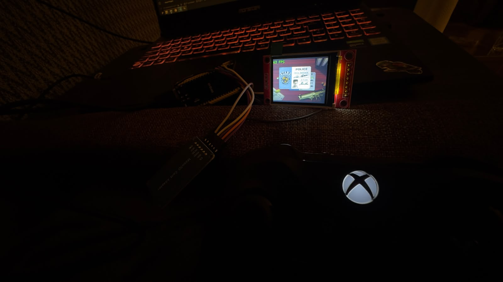
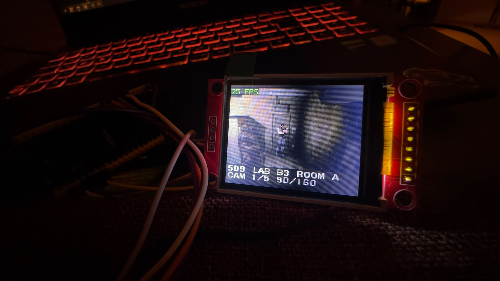
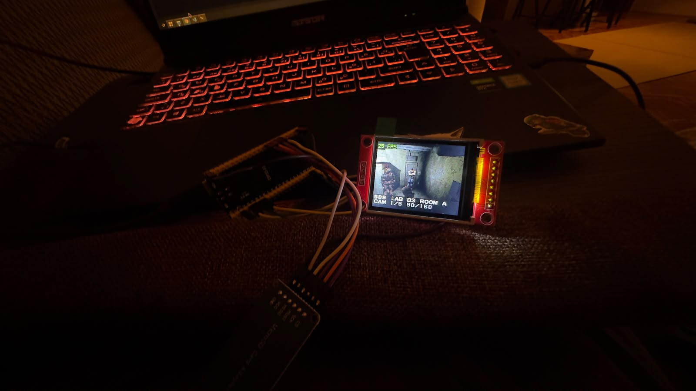
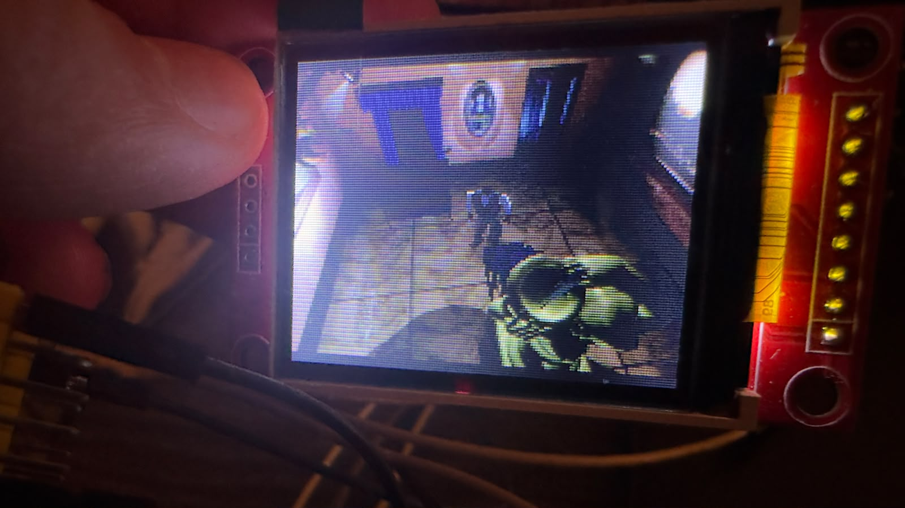

# r-esp32-evil

Resident Evil (PC, 1997) running on an **ESP32-S3** microcontroller, with a
1.8" SPI screen, a micro-SD card, an I2S DAC and a Bluetooth Xbox controller.



The game itself is not rewritten. All game logic comes from the
[Resident Evil PC decompilation](https://github.com/ecruells/resident-evil-pc-decomp)
by Eduardo Cruells and contributors. This project adds a new *platform* for it:
a software renderer (the ESP32 has no GPU), an audio mixer that streams from
the SD card, a movie player, the ESP32-S3 drivers, Bluetooth controller
support, a PC simulator and a browser view for testing.

> **No game data is included or downloaded.** You need your own copy of
> Resident Evil for PC (the GOG release or the 1997 retail USA version). The
> tools here convert *your* files for the board.

Full build guide with every detail: **[docs/GUIDE.md](docs/GUIDE.md)**.

---

## Contents

- [Gallery](#gallery)
- [Where the code comes from](#where-the-code-comes-from)
- [How it works](#how-it-works)
- [Status](#status)
- [Parts](#parts)
- [Wiring](#wiring)
- [Software setup](#software-setup)
- [Step by step](#step-by-step)
- [The SD card](#the-sd-card)
- [Xbox controller over Bluetooth](#xbox-controller-over-bluetooth)
- [Controls](#controls)
- [Tools and commands](#tools-and-commands)
- [Reading the console](#reading-the-console)
- [Troubleshooting](#troubleshooting)
- [Project layout](#project-layout)
- [References](#references)
- [License](#license)

---

## Gallery

| | |
|---|---|
|  |  |
| The whole build: ESP32-S3 board, ST7735 screen, micro-SD adapter, Xbox controller | The same frame on the board and in the browser view (`re1tool.py web`) |
|  |  |
| The intro movie, converted to the board's `.rv1` format | Character select |
|  |  |
| The room tour (benchmark) in the lab, with the room/camera band | A busy scene: several enemies close to the camera, ~25 fps |
|  | |
| 3D models on the 160×120 software renderer | |

---

## Where the code comes from

| Part | Source |
|---|---|
| Game logic (~158k lines: scripts, AI, rooms, menus, the PS1-style 3D pipeline) | [ecruells/resident-evil-pc-decomp](https://github.com/ecruells/resident-evil-pc-decomp), GPL-3.0 |
| Pinned decomp version | commit `76119e852733d6d58c76888ece32f879a36bf6a0` ([patches/DECOMP_COMMIT](patches/DECOMP_COMMIT)) |
| Changes to the decomp | one patch, [patches/0001-r-esp32-evil-port-hooks.patch](patches/0001-r-esp32-evil-port-hooks.patch). Every change is behind a macro that the upstream builds never define, so without them the decomp builds exactly as upstream |
| Everything else (renderer, audio, movies, drivers, Bluetooth, tools) | this repository |

The decomp is **not copied** into this repository. `python3 tools/re1tool.py fetch`
clones it at the pinned commit into `decomp/` and applies the patch.

---

## How it works

The decomp already separates the game from the operating system: its Linux
build swaps in an SDL2 platform layer and an OpenGL renderer. This project
adds one more platform next to those:

```text
decomp/src/game, marni, system    the game (upstream + patches/*.patch)
          │   platform.h · MarniDX · DirectSound · CMarniDirectInput
port/                             this project, shared by every target
  marni/MarniDX_SW.cpp            software rasteriser (replaces OpenGL)
  common/Audio.cpp                mixer + SD streaming (replaces SDL audio)
  common/Video.cpp                .rv1 movie player (replaces ffmpeg)
  common/Platform.cpp, Input.cpp  files, keys, pad
  common/Remote.cpp               browser link (frames out, keys in)
          │   re1_target.h
firmware/components/re1_board     ESP32-S3: ST7735, SD, I2S, ADC/GPIO, Bluetooth, FreeRTOS
port/host                         PC host simulator (same code, native binary)
```

In short:

- **Picture.** The game thinks it draws to a 320×240 screen. The software
  renderer draws at 160×120 (every coordinate halved, every texture
  pre-shrunk), which fits the 160×128 panel. Game core 1 draws the next frame
  while core 0 sends the finished one to the panel over SPI DMA.
- **Memory.** The game's fixed buffers (5 MB) and the heap live in the 8 MB
  PSRAM. Only the framebuffers, depth buffer and a few hot functions use the
  small internal RAM.
- **Data.** The game reads its original files from the SD card. Only movies
  are converted (to a small palette format the board can show without a video
  decoder), and small sound banks are made 8-bit to save RAM.
- **Sound.** An integer mixer at 22 050 Hz stereo, out through I2S to a
  PCM5102A. Music and long voice clips stream from the card.
- **Testing.** The same port code also builds as a PC program (the *host
  simulator*) and runs in Espressif's QEMU. All three can show their picture
  in a browser page and take keyboard input from it.

---

## Status

| | |
|---|---|
| ESP32-S3 board | **Plays.** Movies, title, character select, the mansion, the lab. Saving and loading on the SD card. Bluetooth Xbox controller |
| Speed | 30 fps (the game's own tick rate) in most rooms; ~25 fps in heavy scenes with several enemies near the camera |
| Sound | the mixer runs on the board; use `cmd tone` to check your DAC wiring |
| PC host simulator | plays the whole game, with sound in the browser |
| QEMU | the real firmware boots and runs the mansion hall (no sound) |
| Not tested | Director's Cut / Saturn content on the board |

---

## Parts

| Part | Notes |
|---|---|
| ESP32-S3 **N16R8** dev board (16 MB flash, 8 MB octal PSRAM) | The common "DevKitC-1" clone with two USB-C ports (**COM** and **USB**). The 8 MB PSRAM is required |
| 1.8" SPI TFT, 128×160, **ST7735(S)** | The red module with pins `LED SCK SDA A0 RESET CS GND VCC` |
| Micro-SD card adapter (with 74VHC125 buffer and 3.3 V regulator) | Pins `CS SCK MOSI MISO VCC GND`. **Must be fed 5 V** |
| **PCM5102A** I2S DAC module | Pins `VIN GND LCK DIN BCK SCK`, 3.5 mm output |
| Micro-SD card | 1 GB or larger, FAT32. The prepared game is about 650 MB |
| Xbox Wireless Controller (optional) | Model 1708 (One S) or Series X\|S, firmware 5.x — see [below](#xbox-controller-over-bluetooth) |
| Analog joystick(s) and 4–5 push buttons (optional) | If you do not use a Bluetooth controller |
| Jumper wires | Keep SPI wires short (under 15 cm), especially for the SD card |

---

## Wiring

All pins below are the defaults. They can be changed with `idf.py menuconfig`
→ **r-esp32-evil**. The defaults avoid the pins the N16R8 module uses
internally (GPIO 26–37 flash/PSRAM, 19/20 USB, 43/44 console, 0/45/46 boot
straps, 48 RGB LED).

### Display — ST7735 on SPI2

| TFT pin | ESP32-S3 |
|---|---|
| VCC | 3V3 |
| GND | GND |
| SCK | GPIO 12 |
| SDA (MOSI) | GPIO 11 |
| A0 (DC) | GPIO 9 |
| RESET | GPIO 14 |
| CS | GPIO 10 |
| LED (backlight) | GPIO 21 |

### SD card — SPI3

| SD adapter | ESP32-S3 |
|---|---|
| VCC | **5V** |
| GND | GND |
| CS | GPIO 39 |
| SCK | GPIO 40 |
| MOSI | GPIO 41 |
| MISO | GPIO 42 |

The adapter has its own 3.3 V regulator and needs a real 5 V on VCC. With a
weak or missing 5 V the card often still *reads*, but every *write* is
silently lost (saves vanish, settings are not kept). Measure the 5V pin: it
should be 4.6–5.1 V. On some dual-USB boards the 5V pin only works from one
USB port, or needs the `IN-OUT` solder jumper closed.

### Audio — PCM5102A on I2S0

| PCM5102A | ESP32-S3 |
|---|---|
| VIN | 3V3 (or 5V) |
| GND | GND |
| BCK | GPIO 15 |
| LCK | GPIO 16 |
| DIN | GPIO 17 |
| SCK | **GND** |

Solder jumpers on the back of the module: `H1L` (FLT) → L, `H2L` (DEMP) → L,
`H3L` (XSMT) → **H**, `H4L` (FMT) → L. Many modules ship with XSMT floating,
which keeps the DAC muted.

### Joystick and buttons (optional)

| Control | ESP32-S3 |
|---|---|
| Joystick VRx / VRy | GPIO 1 / GPIO 2 |
| Joystick SW (press) | GPIO 47 |
| Joystick +5V / GND | **3V3** / GND |
| ACTION button | GPIO 6 → GND |
| RUN button | GPIO 7 → GND |
| AIM button | GPIO 8 → GND |
| INVENTORY button | GPIO 18 → GND |
| OPTIONS button | GPIO 3 → GND |
| Second joystick (optional) VRx / VRy | GPIO 4 / GPIO 5 |

Buttons connect the GPIO to GND (internal pull-ups are on). Keep the sticks
centred while the board boots: the resting position is measured at start-up.

### Power

Power the board from either USB-C port. It draws about 150–300 mA. The
board's 5V pin feeds the SD adapter.

---

## Software setup

Tested on Linux (x86-64). macOS and WSL2 should work for everything except
the 32-bit host simulator on macOS.

```bash
# Fedora
sudo dnf install git cmake ninja-build gcc-c++ glibc-devel.i686 libstdc++-devel.i686 \
                 ffmpeg python3-pillow python3-numpy python3-pyserial dosfstools
# Debian / Ubuntu
sudo apt install git cmake ninja-build g++ g++-multilib ffmpeg \
                 python3-pil python3-numpy python3-serial dosfstools
```

ESP-IDF 5.5 (and QEMU, only if you want the emulator):

```bash
mkdir -p ~/esp && cd ~/esp
git clone -b v5.5.6 --recursive --shallow-submodules \
    https://github.com/espressif/esp-idf.git esp-idf-v5.5.6
cd esp-idf-v5.5.6
./install.sh esp32s3
python tools/idf_tools.py install qemu-xtensa      # optional
```

`re1tool.py` finds ESP-IDF in `~/esp/esp-idf*` or `$IDF_PATH` by itself. Run it
from a **plain** shell, not one where ESP-IDF's `export.sh` was sourced (that
puts ESP-IDF's Python first, which has no Pillow/numpy).

---

## Step by step

```bash
# 1. Get the code and the decomp
git clone https://github.com/smhgzll/r-esp32-evil.git
cd r-esp32-evil
python3 tools/re1tool.py fetch

# 2. Convert your game files into an SD-card tree
python3 tools/re1tool.py prepare --game "/path/to/Resident Evil" --out ~/re1-sd

# 3. (optional) Try it on the PC first - opens http://127.0.0.1:8080/
python3 tools/re1tool.py host --data ~/re1-sd

# 4. Copy the tree to a FAT32 card
python3 tools/re1tool.py sdcard --from ~/re1-sd --mount /run/media/$USER/RE1

# 5. Build and flash the firmware (use the COM port of the board)
python3 tools/re1tool.py build
python3 tools/re1tool.py flash -p /dev/ttyACM0 --monitor
```

The serial port is `/dev/ttyACM0` or `/dev/ttyUSB0` on Linux, `COMx` on
Windows. If flashing does not start: hold **BOOT**, tap **RST**, release BOOT.

On the first boot the console shows the panel, the card, the audio and the
renderer coming up, then the Capcom logo movie starts.

---

## The SD card

**Format:** FAT32 (not exFAT), 1 GB or larger. Either use your desktop's disk
tool or let the script do it:

```bash
lsblk                                                       # find the card - be sure!
python3 tools/re1tool.py sdcard --from ~/re1-sd --format /dev/sdX1
```

`--format` asks you to type the device name again, then runs
`sudo mkfs.vfat -F 32`.

**Copy:** mount the card and run `sdcard --from ~/re1-sd --mount <mount point>`.
Only missing or changed files are copied, so updating a card is fast. Unmount
before you pull it out.

**What ends up on the card:**

```text
re1/
  config.ini      settings (the game's own file + a [Port] section)
  save/           save games (savedat1.dat ... savedat8.dat)
  usa/            the game tree, all names lower-case
    data/ enemy/ players/ stage1..7/ objspr/ effspr/ item_m1/ item_m2/ sound/ voice/
    movie/*.rv1   the movies, converted for the panel
```

The `re1/` folder must be at the root of the card. The firmware mounts the card
at `/sd` and uses `/sd/re1`.

**What `prepare` changes:**

| Data | Conversion |
|---|---|
| File and folder names | lower-cased |
| Movies (`.avi`, Cinepak 320×240) | → `.rv1`: 160×120, 256 colours per frame, 22 kHz mono sound |
| Small sound banks | → 8-bit PCM (halves their RAM) |
| Music, long voice clips | copied (streamed from the card) |
| Backgrounds, textures, models, rooms | copied unchanged |

`prepare` options: `--no-movies` (skip the slow movie step), `--video-codec rgb565`
(full-colour movies, bigger files), `--audio keep` (no 8-bit conversion),
`--skippable-fmv` (every movie can be skipped), `--force` (rebuild all),
`-j N` (parallel jobs). Check a tree with `python3 tools/re1tool.py check ~/re1-sd`.

**Settings on the card** (`re1/config.ini`):

```ini
[Game]
SkipUnskippableFmv=0    ; 1 = every movie can be skipped
[Port]
TextScale=2.0           ; size of message text (1.0 - 2.5)
MenuTextScale=2.0       ; size of the menu font
ShowFps=1.00            ; frame rate counter in the corner
```

**Checking the card from the PC** while the board runs with the browser view
(see [Tools and commands](#tools-and-commands)):

```bash
python3 tools/re1tool.py cmd sdtest    # write, read back and compare test files
python3 tools/re1tool.py cmd saves     # list the save folder
```

The board reads back every sector it writes. If a write did not reach the card
the console says `SD write of sector N did not stick` — almost always the 5 V
supply of the SD adapter.

---

## Xbox controller over Bluetooth

The board can use an **Xbox Wireless Controller** as its gamepad, with no extra
hardware.

**Which controllers work.** The ESP32-S3 only has **Bluetooth Low Energy**
(no classic Bluetooth). Xbox controllers speak BLE from **firmware 5.x** on:

- Xbox One S controller (model 1708) — needs a firmware update if it is still
  on 3.x/4.x
- Xbox Series X|S controller (model 1914) — BLE out of the box
- The original Xbox One controller (models 1537/1697) has no Bluetooth at all

Other BLE HID gamepads may work too (the board accepts any device that
advertises itself as a gamepad or joystick), but the button layout is tuned
for the Xbox one.

**Updating the controller firmware.** Use the *Xbox Accessories* app on
Windows 10/11 (connect the controller by USB cable) or on an Xbox console.
On Linux you can check the version with
`lsusb -v -d 045e: | grep bcdDevice` (`3.xx` = classic Bluetooth only,
`5.xx` = BLE). To update from Linux, use a Windows virtual machine with USB
pass-through. Three things keep the controller from reconnecting in a loop
during the update: turn off automatic USB redirection in the VM viewer, pass
the controller as a fixed host device, and keep the Linux `xpad` driver away
from it (`sudo modprobe -r xpad`, blacklist it if it comes back).

**Pairing.**

1. Power the board. The console says
   `pad: Bluetooth up - hold the controller's pair button to connect it`.
2. Switch the controller on and hold its **pair button** (small button on the
   top, next to the USB port) until the Xbox logo flashes fast.
3. The console shows `pad: found ..., connecting` and `pad: connected: Xbox Wireless Controller`.

The board remembers the controller (the bond is stored in flash, up to 4
devices). Next time just switch the controller on: the board scans whenever no
controller is connected and takes it back. To forget all paired controllers,
erase the `nvs` partition:

```bash
python $IDF_PATH/components/partition_table/parttool.py --port /dev/ttyACM0 \
    erase_partition --partition-name=nvs
```

**Button mapping.**

| Game action | Xbox controller |
|---|---|
| Move / turn | left stick or D-pad |
| Action / confirm | A |
| Run / cancel | B or LT |
| Aim (hold) | X, LB, RB or RT |
| Inventory | Y or Menu |
| Options | View |
| Port menu | Xbox button |

**How it works.** NimBLE (ESP-IDF's BLE stack) scans and connects; ESP-IDF's
`esp_hid` host reads the controller's HID-over-GATT input reports;
[gamepad_ble.cpp](firmware/components/re1_board/gamepad_ble.cpp) turns the
16-byte Xbox report (sticks, triggers, hat, buttons) into the game's pad bits
and merges them with the board's own buttons. Bluetooth starts only after the
renderer has taken its buffers, because the Bluetooth controller needs about
45 KB of the small internal RAM. It is enabled in `sdkconfig.defaults`
(`CONFIG_BT_*`) and off in the QEMU profile.

---

## Controls

| Game action | Board buttons | Keyboard (browser) | Gamepad |
|---|---|---|---|
| Move / turn | joystick 1 | arrow keys | left stick / D-pad |
| Action / confirm | ACTION | `C` or `Enter` | A |
| Run / cancel | RUN | `V` | B, LT |
| Aim (hold) | AIM | `X` | X, LB, RB, RT |
| Inventory | INVENTORY or stick press | `Z` | Y, Menu |
| Options | OPTIONS | `Esc` | View |
| Port menu | OPTIONS + INVENTORY | `M` | Xbox button |

The game uses "tank" controls: up walks forward, left/right turn, down walks
back. Hold RUN while walking to run; hold AIM and press ACTION to shoot.

**Port menu** (opens anywhere, pauses the game): FPS counter, text size,
invincible, invisible, give item, full health, room tour, auto tour.

**OPTIONS > EXTRAS** and **OPTIONS > BENCHMARK** are added to the game's own
options screen: text size, cheats and FPS counter, and a room tour that visits
every room and camera and prints load times and frame rates to the console.

---

## Tools and commands

Everything goes through one script: `python3 tools/re1tool.py <command>`.

| Command | What it does |
|---|---|
| `fetch [--update]` | Clone the decomp at the pinned commit into `decomp/` and apply the patch. Safe to re-run; do not edit files in `decomp/`, change the patch instead |
| `prepare --game DIR --out DIR` | Convert your game copy into an SD-card tree (see [The SD card](#the-sd-card)) |
| `check TREE` | Sanity-check a prepared tree |
| `sdcard --from DIR --mount MNT` | Copy the tree to a mounted card (only changed files). `--format DEV` formats it FAT32 first |
| `build [--qemu]` | Build the firmware (`firmware/build`, or `firmware/build-qemu` for QEMU) |
| `flash -p PORT [--monitor]` | Flash the board, optionally open the console |
| `monitor -p PORT` | Serial console (2 000 000 baud) |
| `web --serial PORT` | Browser view of the real board: the bridge reads frames and the log from the serial port and sends keys back. Open `http://127.0.0.1:8080/` |
| `host --data DIR` | Build and run the PC host simulator with the browser view |
| `qemu --data DIR` | Build the QEMU profile and run the real firmware in Espressif's QEMU with the browser view |
| `room ROOM [CAMERA] [--auto]` | Jump the running target to a room (hex id, e.g. `112`) on the room tour |
| `cmd TEXT` | Send a text command to the running target (table below) |

`room` and `cmd` talk to a running bridge (`web`, `host` or `qemu`).

**Text commands** (`python3 tools/re1tool.py cmd ...`):

| Command | Effect |
|---|---|
| `room 112` | Go to room 112 on the room tour. From the title it skips the movies and starts a new game for it |
| `room 112 2` | ... and switch to its 2nd camera |
| `cam 2` | Switch the camera in the current room |
| `auto [112]` | Auto tour (every camera of every room, 2 s each), from that room or the first |
| `stop` | End the tour |
| `save 1` / `load 1` | Save the game in progress to slot 1–8 / load it back |
| `saves` | List the save folder |
| `sdtest` | Write, read back and compare test files on the card, then delete them |
| `tone` | Play 2 s of 440 Hz on the DAC and report whether the game's own mix was silent |

The browser page also has a *Go to room* box, an on-screen pad for touch
screens, gamepad support (browser Gamepad API) and the console log.

**Browser view on the real board.** Enable *r-esp32-evil → Stream frames to
the browser bridge over UART0* in `idf.py menuconfig`, rebuild, flash, then
`python3 tools/re1tool.py web --serial /dev/ttyACM0`. The panel keeps working;
the browser mirrors it (a few frames per second for full-screen changes at
2 Mbaud). Turn it off for normal play.

**Host simulator without a browser** (for scripted tests):

```bash
build/host/re1_host --data ~/re1-sd/re1 --no-port --ticks 900 \
    --press 67 200 4 --capture 600 frame.ppm          # press 'C' at tick 200 for 4 ticks
build/host/re1_host --data ~/re1-sd/re1 --no-port --ticks 900 \
    --cmd 40 "room 112 2" --capture 880 room.ppm      # a text command at tick 40
```

Captures at a fixed tick are identical from run to run (except during movies),
so renderer changes can be checked by comparing files byte for byte.

**Firmware options** (`cd firmware && idf.py menuconfig` → *r-esp32-evil*):
all pins, LCD SPI clock (27 MHz), panel orientation/BGR/offsets for the
different 1.8" panel variants, SD SPI clock, audio volume, joystick dead zone,
second-joystick mode, browser streaming.

---

## Reading the console

The console (`monitor`, or the log panel of the browser page) tells you what
the board is doing:

| Line | Meaning |
|---|---|
| `re1: memory (data cache): PSRAM copy 30 MB/s ...` | memory speed test at boot |
| `[RE1] ... heap free ... largest ... internal=` | memory status; `internal=` is free internal RAM |
| `[PERF] ... 26.9 ms/frame: game ... tmd ... raster ... sprite ...` | every 5 s: where a frame's time goes (33 ms = 30 fps) |
| `[WORK] per frame: obj ... tri ... tripx ...` | how much work each stage did per frame |
| `[BENCH] ...` | room tour: load time, frame rate, worst frame per room |
| `[SAVE] ...` | save files written and listed |
| `pad: ...` | Bluetooth controller: scanning, connected, battery |
| `SD read ... recovered` / `did not stick` | SD card problems (wiring or power) |

---

## Troubleshooting

| Symptom | Check |
|---|---|
| `SD mount failed` | Card is FAT32 (not exFAT); adapter VCC on **5 V**; short wires; lower *SD SPI clock* |
| Saves missing, settings not kept, `did not stick` | SD adapter's 5 V supply (see [Wiring](#sd-card--spi3)); run `cmd sdtest` |
| No sound | Run `cmd tone`. No beep: PCM5102A SCK to GND, XSMT jumper high, check BCK/LCK/DIN |
| White or garbled screen | Lower the LCD SPI clock (e.g. 16 MHz), check A0/RESET |
| Red and blue swapped | Toggle *Panel is BGR* in menuconfig |
| Picture shifted, garbage line at an edge | Set the column/row offset (1 or 2) |
| Mirrored or upside down | MADCTL `0x60`, `0xE0` or `0x20` |
| Character walks by itself | Sticks were not centred at boot, or raise the dead zone |
| Controller does not connect | Firmware 5.x? Hold the pair button until the logo flashes fast; watch the `pad:` lines |
| Console shows garbage | The console runs at 2 000 000 baud |
| `ModuleNotFoundError: PIL` | Run `re1tool.py` from a shell where ESP-IDF's `export.sh` was not sourced |

More in [docs/GUIDE.md §15](docs/GUIDE.md#15-troubleshooting).

---

## Project layout

```text
patches/                    the decomp patch + pinned commit
port/include/               target API (re1_target.h), browser link protocol (re1_remote.h), ...
port/common/                platform layer shared by all targets (audio, video, input, files, port menu)
port/marni/                 the software renderer
port/host/                  PC host simulator (CMake, 32-bit like the decomp's Linux build)
firmware/                   ESP-IDF project
  main/                     app_main + Kconfig (pins and options)
  components/re1/           the game library (decomp + port)
  components/re1_board/     ST7735, SD card, I2S, input, Bluetooth pad, UART link, QEMU file access
  sdkconfig.defaults        board profile (sdkconfig.qemu = QEMU overlay)
tools/re1tool.py            the tool for everything above
tools/web/index.html        the browser page
docs/GUIDE.md               the full build guide
gallery/                    photos
```

---

## References

- [ecruells/resident-evil-pc-decomp](https://github.com/ecruells/resident-evil-pc-decomp) — the Resident Evil PC decompilation this port is built on (GPL-3.0)
- [ESP-IDF](https://github.com/espressif/esp-idf) — Espressif's framework for the ESP32-S3 (FreeRTOS, drivers, FATFS, NimBLE, esp_hid) · [documentation](https://docs.espressif.com/projects/esp-idf/en/stable/esp32s3/)
- [Espressif QEMU](https://github.com/espressif/qemu) — the ESP32-S3 emulator used for the QEMU target
- [ESP32-S3](https://www.espressif.com/en/products/socs/esp32-s3) — chip datasheet and technical reference manual
- [Apache NimBLE](https://github.com/apache/mynewt-nimble) — the Bluetooth LE host stack inside ESP-IDF
- [PCM5102A](https://www.ti.com/product/PCM5102A) — Texas Instruments I2S DAC
- Sitronix ST7735S datasheet — the display controller
- Bluetooth SIG *HID over GATT Profile* (HOGP) — how BLE gamepads send their input
- *Xbox Accessories* app (Microsoft Store / Xbox) — controller firmware updates

---

## License

Copyright (C) 2026 [smhgzll](https://github.com/smhgzll)

This project is licensed under the **GNU General Public License v3.0** — see
[LICENSE](LICENSE). The decompilation it builds on is GPL-3.0 and this port
links with it, so the port uses the same license.

The license covers only the source code in this repository. It gives no rights
to the original game. *Resident Evil*, its code, assets, characters and
trademarks are the property of **CAPCOM CO., LTD.** This project contains no
game data, is not affiliated with or endorsed by Capcom, and needs your own
legally obtained copy of the game.

**Author:** [smhgzll](https://github.com/smhgzll)
